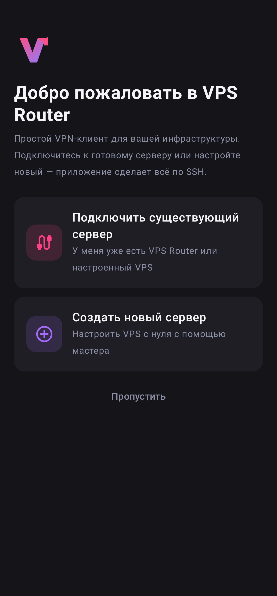
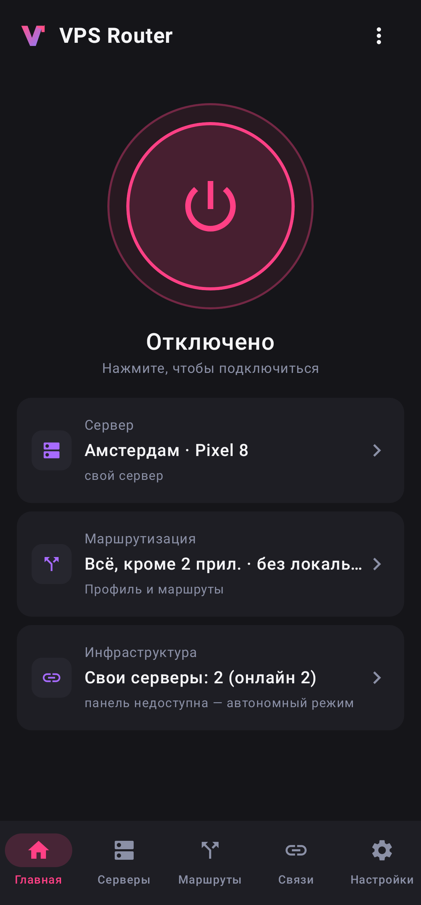
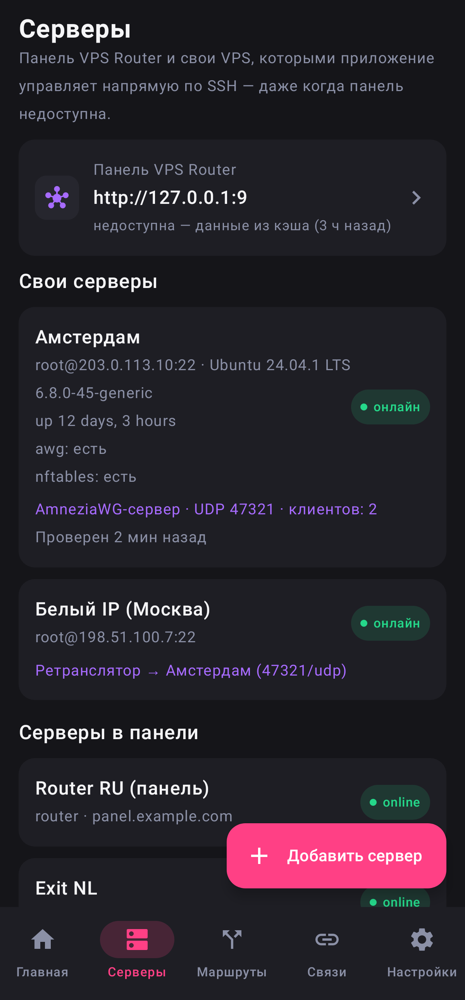
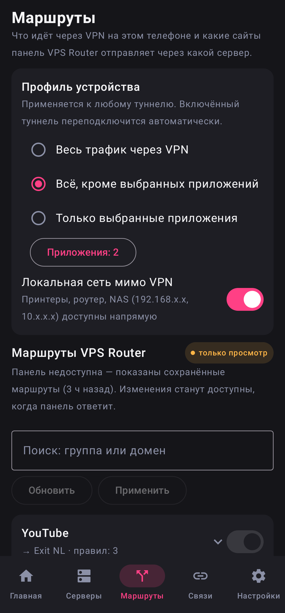
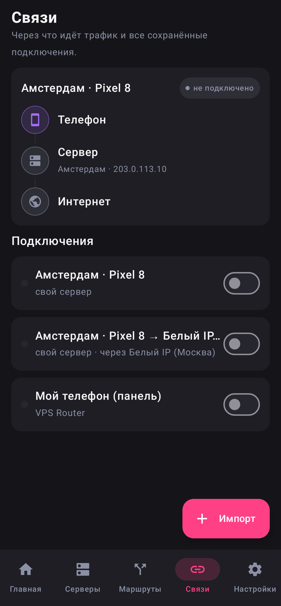
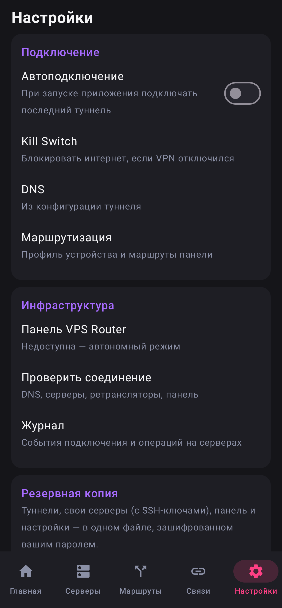
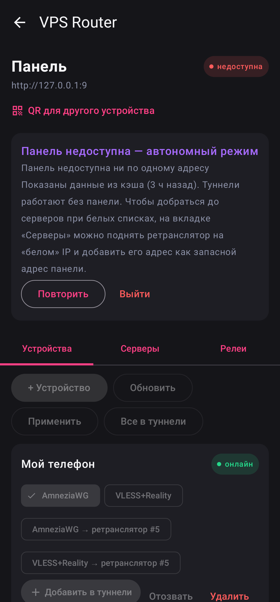
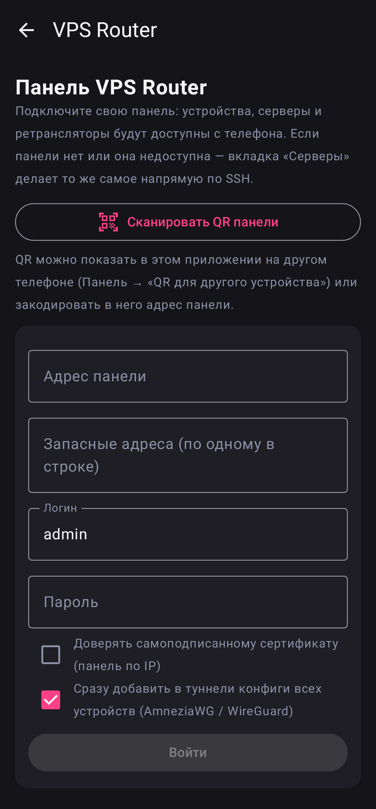
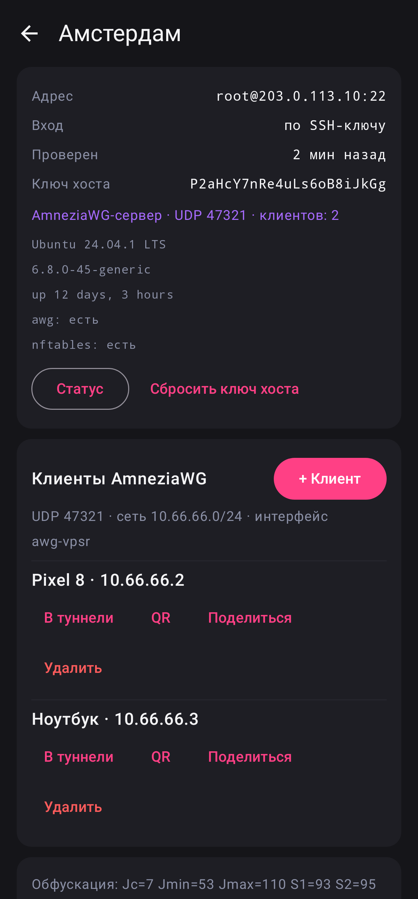

# VPS Router для Android

Android-клиент для [vps_router](https://github.com/iYgen/vps-router): VPN-туннель AmneziaWG (как в приложении AmneziaWG) плюс управление инфраструктурой — через панель VPS Router или напрямую по SSH, если панели нет или она недоступна.


## Возможности

**Туннели (VPN-клиент)**
- AmneziaWG и WireGuard: userspace-бэкенд `amneziawg-go` через `VpnService`, root не нужен. Поддерживаются параметры обфускации AWG 1.x и 2.x (Jc…H4, S3/S4, I1–I5).
- Импорт из QR-кода, файла `.conf` (в том числе через «Открыть с помощью…»), вставкой текста; экспорт в QR-код, файл и буфер обмена.
- Большая кнопка подключения, трафик и время последнего рукопожатия, плитка в шторке быстрых настроек.
- Копия любого туннеля «через ретранслятор»: подменяется только `Endpoint`, ключи остаются прежними.

**Панель VPS Router (подключённый режим)**
- Вход тем же способом, что и в браузере: сессия, CSRF-токен, 2FA (TOTP). Можно указать запасные адреса панели, например адрес через ретранслятор.
- Устройства: создание через мастер (протокол включается автоматически), импорт AWG/WG-конфига в туннели одной кнопкой, ссылки VLESS/Hysteria2 открываются в v2rayNG, Hiddify или Happ. Также можно отозвать, разрешить или удалить устройство и нажать «Применить».
- Серверы и связи-ретрансляторы панели со статусами.
- Мастер «Ретранслятор через панель»: узел `role=relay` → `bootstrap-ssh` → связь `relay` → `provision`. Затем импортируются конфиги устройств «через ретранслятор».
- Если панель недоступна — показывается кэш, а всё остальное продолжает работать.

**Свои серверы (автономный режим, без панели)**
- Мастер: SSH-доступ (пароль или ключ) → проверка подключения. По желанию приложение создаёт SSH-ключ и дальше входит по нему. Ключ хоста запоминается при первом подключении (TOFU), при его смене подключение прерывается.
- **VPN-сервер AmneziaWG**: установка через `install_amneziawg` из `_lib.sh` vps_router, случайные валидные параметры обфускации, NAT, автозапуск через systemd. Клиенты добавляются и удаляются через `awg syncconf`, без разрыва связи у остальных.
- **Ретранслятор для белых списков**: используется тот же `deploy/provision/relay-forward.sh` (nftables DNAT + masquerade). Цели — свой AWG-сервер, роутер VPS Router или произвольный IP. Туннели своего AWG-сервера автоматически получают вариант «через ретранслятор».
- **Установка панели VPS Router** на чистый VPS: `git clone` + `deploy/bootstrap.sh`. После установки показывается ссылка мастера `install.php?t=…`.
- Секреты (ключи туннелей, SSH-ключи и пароли, логин панели) хранятся в файле, зашифрованном AES-256-GCM ключом из Android Keystore.

## Скриншоты

| | | |
|---|---|---|
|  |  |  |
|  |  |  |
|  |  |  |

Скриншоты рендерятся скриншот-тестами (Robolectric + Roborazzi) из настоящего кода экранов: `./gradlew :app:testDebugUnitTest` → `docs/screenshots/`. Пример инфраструктуры для них лежит только в тесте.

## Структура

```
tunnel/                 AmneziaWG: Java-слой из amneziawg-android (Apache-2.0) + libwg-go.so
app/src/main/
  assets/provision/     _lib.sh и relay-forward.sh из vps_router, awg-server.sh, panel-install.sh
  java/app/vpsrouter/client/
    tunnel/             TunnelManager (GoBackend), плитка быстрых настроек
    panel/              PanelClient (HTTP API панели), PanelSession (онлайн/офлайн, кэш)
    local/              LocalOps — автономный режим (AWG, ретранслятор, установка панели)
    ssh/                SSH на JSch: exec, загрузка скриптов во временный каталог 0700, sudo
    awg/                ключи, параметры обфускации, конфиги сервера и клиента
    data/               модели, Repository, SecureStore (Android Keystore)
    ui/                 Jetpack Compose: туннели, панель, серверы, мастера
```

## Сборка

Приложение живёт в каталоге `android/` репозитория vps_router — рядом с панелью, из одного репозитория.
Нужны JDK 17+ и Android SDK (platform 35, build-tools 34/35).

```bash
cd android
echo "sdk.dir=D:/Android/sdk" > local.properties
./gradlew assembleDebug        # app/build/outputs/apk/debug/app-debug.apk (без R8, ~26 МБ)
./gradlew assembleRelease      # с R8, ~8 МБ
./gradlew publishToPanel       # release → panel/app/vps-router.apk + version.json
```

**Почему release меньше debug.** Нативный `libwg-go.so` (AmneziaWG) лежит в обоих APK одинаково — под arm64-v8a, armeabi-v7a, x86 и x86_64, ~14 МБ в сумме. В debug-сборке не работает R8, поэтому в APK попадает весь код библиотек (Compose, полный набор иконок и т. д.): ~60 МБ dex. R8 в release оставляет только используемое (~3.7 МБ dex). Классы, которые вызывает нативная библиотека, защищены правилами `tunnel/consumer-rules.pro`.

**Скрипты установки** `_lib.sh` и `relay-forward.sh` не копируются руками: при каждой сборке они берутся из `deploy/provision/` этого же репозитория. Встроенные в APK только `awg-server.sh` и `panel-install.sh` (они есть только у приложения).

**Подпись.** Ключ релизов — `.secrets/android/release.jks`, пароли — `.secrets/android/keystore.properties` в корне репозитория; каталог `.secrets/` в `.gitignore`. Без них release подписывается debug-ключом. **Сохраните ключ в надёжном месте:** обновление встаёт поверх, только если подписано тем же ключом. При потере ключа приложение придётся удалить и поставить заново.

## Выпуск версии и обновления

1. Увеличьте `versionCode` (и `versionName`) в `app/build.gradle.kts`.
2. Выполните `./gradlew publishToPanel`. Команда положит `panel/app/vps-router.apk` и `version.json` (версия, размер, SHA-256).
3. Закоммитьте вместе с изменениями панели.

Каталог `panel/app/` входит в код панели. Самообновление панели (`SelfUpdater`) приносит его на серверы вместе с остальным кодом. Дальше:

- **Скачать приложение.** В панели есть страница «Приложение» (`/app.php`): кнопка «Скачать APK» и QR для телефона. QR ведёт на временную подписанную ссылку `/app-download.php`, она действует 30 минут. Публичной ссылки нет: по адресу не видно, что на сервере стоит VPS Router.
- **Обновить приложение.** При подключении к панели приложение запрашивает `/api/app.php` и сравнивает `versionCode`. Если в панели версия новее, на главной и в «Настройках → Обновление» появится кнопка «Обновить». Приложение скачивает APK через сессию панели, проверяет размер и SHA-256 и передаёт файл системному установщику. Android дополнительно сверяет подпись.
- **Подгрузить свежие скрипты.** Изменившиеся `_lib.sh` и `relay-forward.sh` приложение скачивает из панели с проверкой SHA-256 и использует вместо встроенных. Исправления скриптов доходят до телефона без новой версии APK. Если версия приложения в панели старше установленной, скрипты из панели не используются.

## Важные детали и ограничения

- **Нативная библиотека AWG.** `tunnel/src/main/jniLibs/*/libwg-go.so` извлечены из официального релиза AmneziaWG `v3.1.20260814`, Java-классы взяты из исходников того же тега. Пакет `org.amnezia.awg` менять нельзя: от него зависят имена JNI-функций. Чтобы собрать `.so` из исходников, нужны Go + NDK по `tunnel/tools` репозитория amneziawg-android.
- **API панели.** Отдельного токен-API у панели нет, поэтому клиент использует браузерную сессию. Списка устройств в JSON тоже нет — он разбирается со страницы `devices.php` (блоки `dev-item`). При изменении вёрстки этой страницы нужно обновить `PanelClient.devices()`. Лучше добавить в панель `api/devices.php` — тогда разбор HTML не понадобится.
- **Внешние зависимости при установке.** Сейчас `install_amneziawg` (PPA/COPR), `jq`, `nftables` и `git clone` для панели скачиваются из интернета. Для режима «ограниченной сети» нужен Bootstrap Kit (см. план ниже).
- Ретранслятор только пересылает порты. Связь с самим VPS-ретранслятором по SSH должна быть доступна.

## План по ТЗ (дальнейшие этапы)

Готово: MVP, ядро этапа 2 и **UI-каркас по ТЗ** — онбординг, главная (кнопка, таймер, скорость, выбор сервера), 5 вкладок, профили маршрутизации (исключить/только приложения, локальная сеть мимо VPN, свои DNS), маршруты панели (вкл/выкл, домены), карта связи, «Проверить соединение», журнал, резервная копия с паролем, QR подключения панели (`vpsrouter://panel?url=…&user=…`) с импортом конфигов всех устройств. Дальше:

1. **Вход без пароля по QR.** QR уже есть и в панели (Настройки → «Мобильное приложение»: адрес, логин, запасные адреса), и в приложении («QR для другого устройства»). Дальше — одноразовый токен в QR вместо ввода пароля (нужен API-токен в панели).
2. **Мастер из 7 шагов.** Роль → SSH (результаты проверок статусами: ОС, архитектура, root/sudo, диск, интерфейсы) → протокол → проверка → установка с пошаговыми статусами и раскрываемым журналом → маршруты → готово. Состояние мастера сохраняется; установка идёт в foreground-сервисе, чтобы не обрываться при сворачивании.
3. **Bootstrap Kit.** Офлайн-комплект в APK: статические бинарники `amneziawg-go`/`awg`/`jq`/`nft` под amd64 и arm64, скрипты, контрольные суммы SHA-256 и подпись. Файлы передаются на VPS по SFTP, установка идёт без интернета. Режим «Ограниченная сеть» — отдельный сценарий с диагностикой доступности.
4. **Маршруты и профили.** Мобильная версия раздела «Маршруты» через API `routes.php`, профили «всё напрямую / выбранное через VPN / всё через VPN». Локально — split tunneling по приложениям и подсетям (AllowedIPs/ExcludedApplications).
5. **Связи и диагностика.** Карта «телефон → вход → ретранслятор → выход», кнопка «Проверить соединение» (SSH, DNS, порт VPN, рукопожатие), помощник по домену (A/AAAA, проверка DNS).
6. **Настройки и синхронизация.** RU/EN, автоподключение, Kill Switch (системный Always-on VPN), резервная копия, журнал, виджет. Синхронизация локальных серверов с панелью с обработкой конфликтов.

Лицензии: код приложения — под лицензией vps_router (AGPLv3); модуль `tunnel` — Apache-2.0 (`tunnel/LICENSE-amneziawg`).
